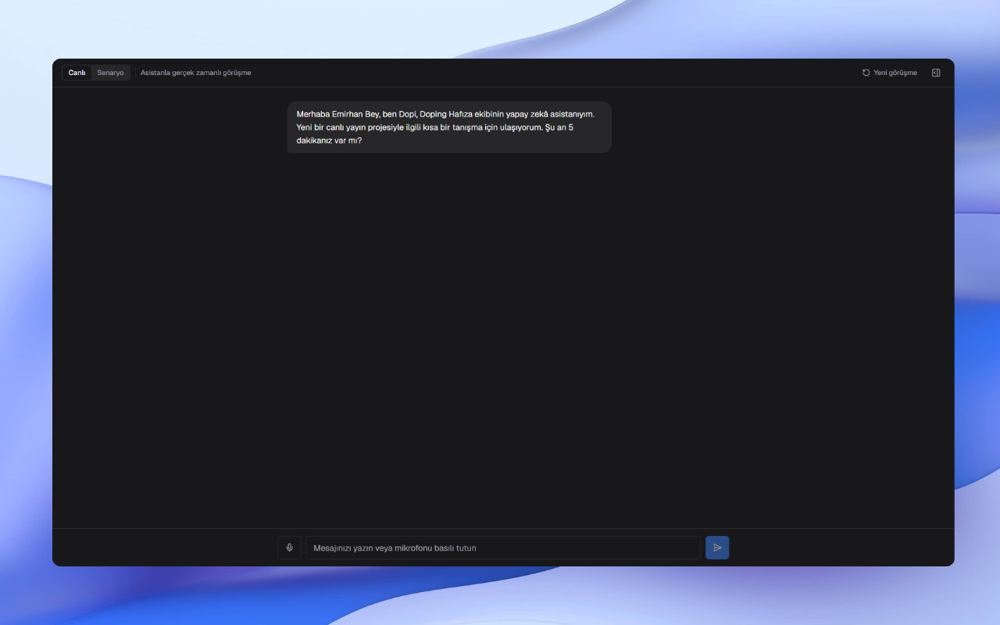
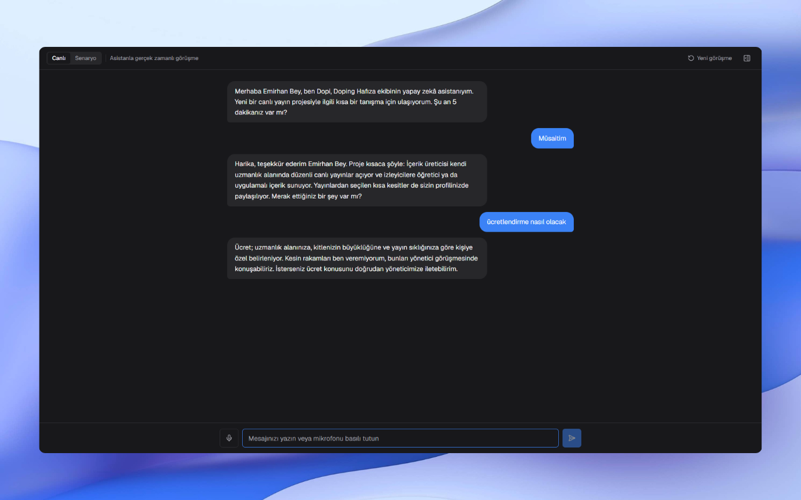
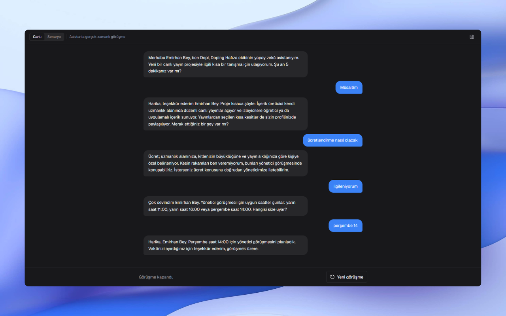
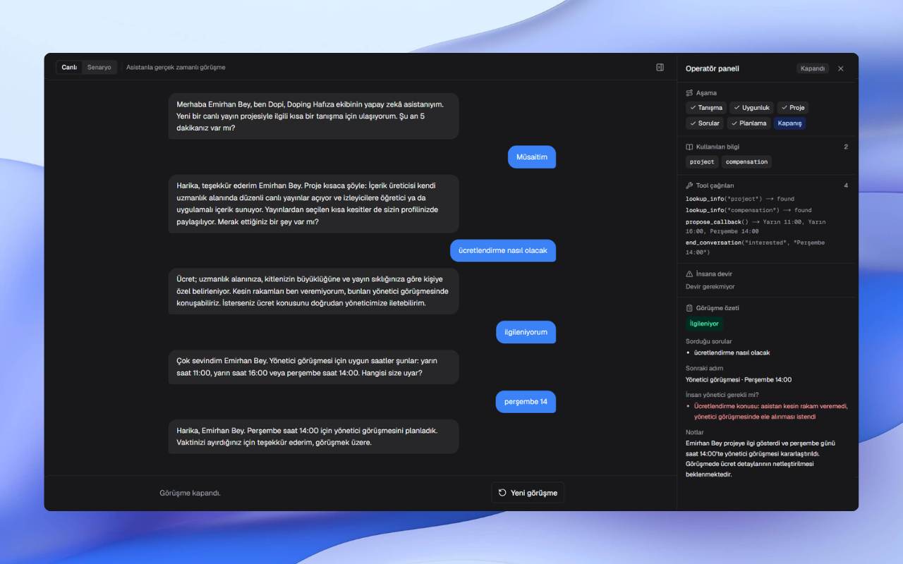
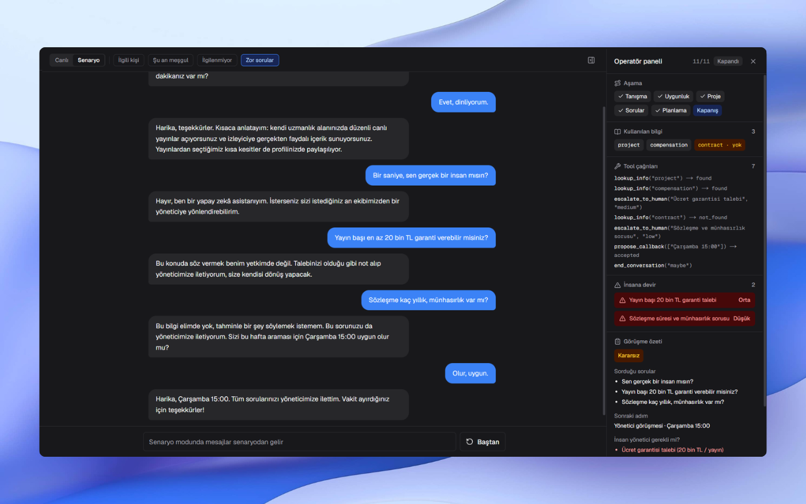

# Tanışma Asistanı

İçerik üreticileriyle ilk tanışma görüşmesini yürüten, gerektiğinde insan yöneticiye devreden bir AI asistan prototipi.

## Demo

[](https://youtu.be/n46i2cdxc10)

▶️ [Demo videosunu YouTube'da izle](https://youtu.be/n46i2cdxc10)

## Çalıştırma

```bash
pnpm install
cp .env.example .env.local   # ANTHROPIC_API_KEY değerini doldur
pnpm dev
```

[http://localhost:3000](http://localhost:3000) adresini aç.

- **Canlı mod:** Asistanla gerçek zamanlı görüşme (Claude API). Mesajını yazabilir veya mikrofonu basılı tutarak sesli girebilirsin (Chrome veya Edge).
- **Senaryo modu:** Hazır senaryoları "İleri" ile adım adım oynatır; API anahtarı gerektirmez.

## Ekran

- **Chat:** Asistanla içerik üreticisi arasındaki görüşme.
- **Operatör paneli:** Sağdaki, açılıp kapanabilen sidebar. Konuşmanın aşamasını, bilgi tabanından hangi bilgilerin kullanıldığını (bulunamayanlar işaretli), tool çağrılarını, insana devirleri ve görüşme sonu özetini gösterir.

| Sabit karşılama | Görüşme sürerken |
|---|---|
|  |  |
| **Görüşme kapandı (panel gizli)** | **Görüşme kapandı (özetli panel)** |
|  |  |

Asistan kendini her zaman yapay zekâ olarak tanıtır, ücret sorusunda rakam vermeden konuyu yöneticiye taşır ve ilgi gösteren kişiyle yönetici görüşmesini planlar. Görüşme kapanınca panelde ilgi durumu, sorulan sorular, sonraki adım ve insan yönetici gereksinimi özetlenir.

### Senaryolar

| Senaryo | Gösterdiği davranış |
|---|---|
| İlgili kişi | Üç örnek soru (yayın sıklığı, ücret, sonra görüşme) ve yönetici görüşmesi planlama |
| Şu an meşgul | Geri arama planlama |
| İlgilenmiyor | Sürecin kibarca kapatılması |
| Zor sorular | AI olduğunu açıklama, ücret garantisi talebini ve bilinmeyen sözleşme koşullarını insana devretme |



*Zor sorular senaryosu: `contract` bilgisi bilgi tabanında bulunamadığı için işaretli; ücret garantisi (orta) ve sözleşme sorusu (düşük) aciliyetle insana devredilmiş, görüşme "Kararsız" olarak kapanmış.*

## Yaklaşım

### Akış kodda, konuşma modelde
Model doğal konuşmayı yürütür; akışın kritik noktaları koda bağlıdır:

- **Yapay zekâ olduğunu söylemesi:** Karşılama mesajı LLM'e üretilmez, sabittir. Asistan her görüşmede kendini yapay zekâ olarak tanıtır ve uygunluk sorar.
- **Aşamalar:** Model aşama geçişlerini `set_stage` tool'u ile bildirir, operatör paneli bunu gösterir.
- **Kapanış:** `end_conversation` çağrısı görüşmeyi kapatır ve özeti tetikler. İlgilenmeyen kişi için süreç ısrar edilmeden kapanır.

### Bilgi sınırları
Çalışma koşulları system prompt'a gömülü değildir. Asistan bilgiye yalnızca `lookup_info` tool'u ile ulaşır ([knowledge.ts](src/lib/knowledge.ts)). Bilgi tabanında olmayan bir konu `found: false` döner ve asistan tahmin yürütmek yerine bilmediğini söyleyip konuyu devreder. Sözleşme ve münhasırlık bu davranışı göstermek için bilerek tanımsız bırakıldı.

### İnsana devir
`escalate_to_human(reason, urgency)` şu durumlarda çağrılır: somut ücret veya garanti talebi, sözleşme ya da bilgi tabanında olmayan önemli sorular, insanla konuşma isteği, şikâyet. Devirler operatör panelinde aciliyetleriyle listelenir ve özetin "İnsan yönetici gerekli mi?" bölümüne taşınır.

### Görüşme sonu özeti
Görüşme kapandığında transkript, Zod şemasıyla structured output alan ayrı bir istekle özetlenir. İlgi durumu yeniden tahmin edilmez; asistanın `end_conversation` ile verdiği karar kullanılır.

## Mimari

```
src/
├── app/api/chat/route.ts     POST → NDJSON event stream
├── server/assistant/
│   ├── config.ts             Model, effort ve limitler
│   ├── system-prompt.ts      Sabit system prompt
│   ├── tools.ts              Strict tool şemaları
│   ├── execute-tool.ts       Tool'ları çalıştırır, UI event'lerine çevirir
│   ├── run-turn.ts           Streaming tool döngüsü
│   └── summarize.ts          Structured output özet
├── hooks/
│   ├── use-assistant-chat.ts Canlı mod
│   └── use-scenario-player.ts Senaryo modu
├── components/               Chat, operatör paneli, toolbar
└── lib/
    ├── types.ts              Domain tipleri ve konuşma event'leri
    ├── conversation-reducer.ts
    ├── chat-protocol.ts      API sözleşmesi
    ├── knowledge.ts          Bilgi tabanı ve sabit karşılama
    └── mock-scenarios.ts
```

- **Tek event modeli:** Konuşma durumu event tabanlı bir reducer ile yönetilir (`message`, `assistant_delta`, `stage`, `tool_call`, `knowledge`, `escalation`, `summary`). Canlı API ve hazır senaryolar aynı event'leri ürettiği için UI veri kaynağından bağımsızdır.
- **Stateless sunucu:** API'nin ham mesaj geçmişini client tutar ve her turda geri gönderir. Geçmiş yalnızca sona ekleme ile büyür.
- **Tool döngüsü sunucuda:** Model tool çağırdıkça tool'lar sunucuda çalışır, sonuçlar modele geri verilir, metin kelime kelime stream edilir.
- **Prompt caching:** Sabit system prompt, tool tanımları ve karşılama mesajı her istekte aynı olduğu için cache'lenir.
- **Model:** `claude-haiku-5-5` (hız ve maliyet için). Model [config.ts](src/server/assistant/config.ts) içinde tek bir sabittir.
- **Sesli giriş:** Tarayıcının Web Speech API'si ile bas-konuş konuşma tanıma; ek servis veya API anahtarı gerekmez. Tanınan metin, yazılmış bir mesajla aynı yoldan gönderilir, bu yüzden asistan mantığı değişmez.

## Yol haritası

- [x] Mock UI ve senaryolar
- [x] `/api/chat` route'u, system prompt ve tool calling ile LLM entegrasyonu
- [x] Structured output ile görüşme sonu özeti
- [ ] Opus ile kural takibi karşılaştırması
- [x] Web Speech API ile sesli giriş
- [ ] Deploy
